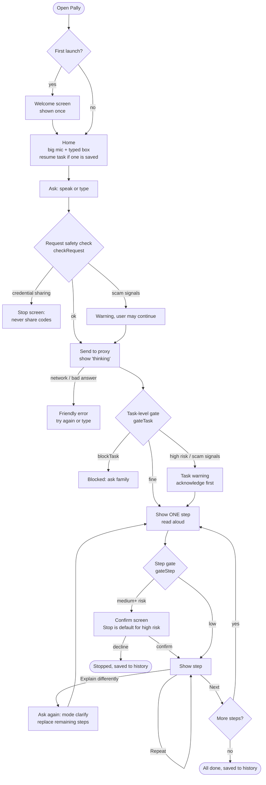
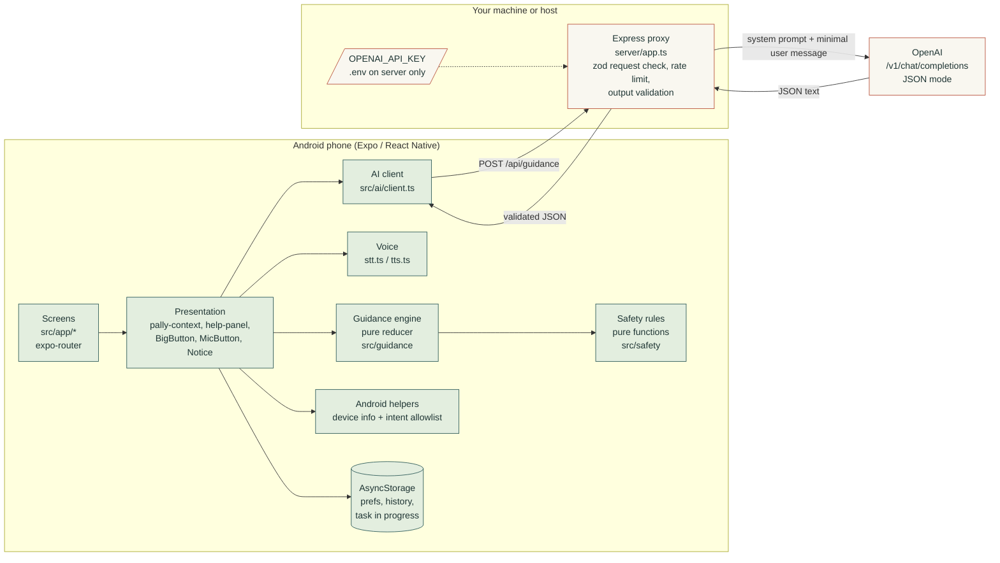
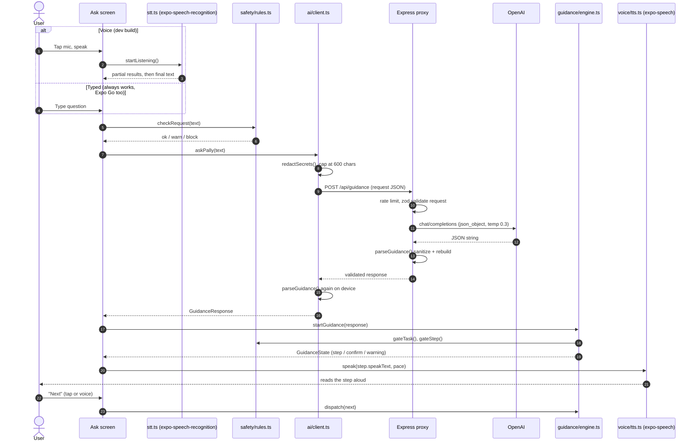
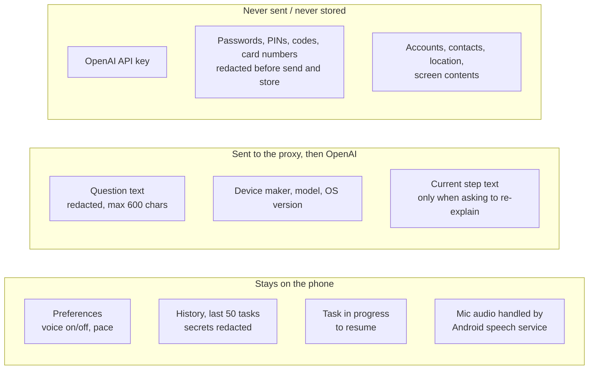
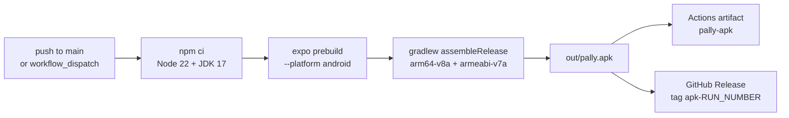
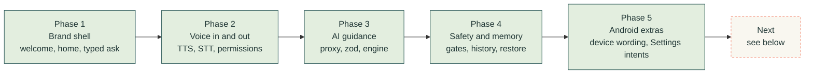

<div align="center">


# Pally

**A patient voice buddy that helps older adults use their Android phone, one small step at a time.**


*Teal for calm. Coral for the one button that matters. Cream so nothing glares.*

</div>

> **Naming note:** early briefs called this project "Companion". The product is **Pally**. Nothing in the app or code uses the old name.

---

## Why Pally exists

Phones change faster than patience does. Many older adults can do almost everything they want on a phone, then get stuck on one menu. Asking family means feeling like a burden. Searching the web means walls of text and ads. A wrong tap can cost real money.

Scams make it worse. Fraud that starts with a phone call, a text, or a "support" person asking to take over the screen mostly works through pressure and secrecy. Fear of looking foolish keeps people from asking for help.

Pally is built around three ideas:

1. **Patience is a feature.** One instruction at a time. It never moves on until you say you are ready. Repeat is always one tap away.
2. **Say it or type it.** Voice is the front door. Typing is always available.
3. **Safety is a layer, not a disclaimer.** Pally checks what you ask, checks what the AI answers, and pauses before risky steps.

---

## Features

| | |
|---|---|
| **Voice and typed** | A large fixed microphone button. Speech-to-text when the build supports it, a typed box always. Steps are read aloud (slow pace by default). |
| **One-step guidance** | The AI returns a list. The app shows exactly one step, with Next, Repeat, Explain differently, Help, Stop. Short voice commands such as "next", "again", "I'm confused" work too. |
| **Safety pauses** | Scam-aware request check, task-level warnings, and a confirmation gate before steps involving money, deleting, installs, permissions or passwords. |
| **On-device history** | Past tasks, preferences and the task in progress live in AsyncStorage on the phone. Secrets are redacted before storing. |
| **No account** | No sign-up, no login, no profile. The only server is a thin proxy that holds the OpenAI key. |
| **Android aware** | Device and OS version tune the wording of menu names. Settings shortcuts open only from an allowlist, after confirmation. |

Design tokens (see `src/constants/theme.ts`): teal `#2D5A58`, coral `#F2967F`, soft green `#A3C59D`, cream `#F9F7F0`. Body text is 22 pt, buttons 26 pt, minimum touch target 64.

---

## User flow



---

## System architecture



The app and server **share one schema file**, `src/ai/schema.ts`. It has no React Native imports, so the Express server imports it directly.

---

## One question, end to end



The response is validated **twice**: once on the server and once on the phone. The second check means a rogue or misconfigured server cannot push unvetted text onto the screen.

---

## Folder and module map

```text
pally/
├─ server/                  Express proxy (run with tsx)
│  ├─ index.ts              boots on 0.0.0.0:$PORT (default 8787), loads .env
│  ├─ app.ts                createApp(env, fetchImpl): routes, limiter, validation
│  └─ prompt.ts             SYSTEM_PROMPT, PROMPT_VERSION, buildUserMessage()
├─ src/
│  ├─ app/                  expo-router screens
│  │  ├─ index.tsx          entry / first-launch routing
│  │  ├─ home.tsx           big mic, typed box, resume saved task
│  │  ├─ ask.tsx            listening / thinking / error states
│  │  ├─ guide.tsx          the one-step-at-a-time experience
│  │  ├─ history.tsx        past tasks (local only)
│  │  └─ settings.tsx       voice on/off, pace, clear data
│  ├─ ai/
│  │  ├─ schema.ts          zod request + response schemas, parseGuidance()
│  │  └─ client.ts          askPally(), friendly errors, API base URL detection
│  ├─ guidance/
│  │  ├─ engine.ts          pure reducer: GuidanceState + GuidanceAction
│  │  └─ commands.ts        parseCommand(): spoken phrase -> control
│  ├─ safety/rules.ts       checkRequest, gateTask, gateStep, redactSecrets
│  ├─ voice/                stt.ts, tts.ts, useSpeechInput.ts
│  ├─ data/                 store.ts (createStorage over any KV), index.ts (AsyncStorage binding)
│  ├─ android/              device info, intents allowlist, screen-context stub
│  ├─ presentation/         context provider, help panel, shared components
│  └─ constants/theme.ts    colors, type sizes, MIN_TARGET
├─ tests/                   vitest: engine, safety, schema, server, store
├─ .github/workflows/android-apk.yml
├─ .env.example
├─ app.json  eas.json
└─ assets/images/           logo, icons, splash
```

### Key files, in a few lines

**`server/app.ts`**: a factory, so tests can inject a fake `fetch`.

```ts
export function createApp(env: ServerEnv, fetchImpl: FetchLike = fetch): Express
```

Routes: `GET /health` (reports `configured` and `model`, never the key) and `POST /api/guidance`. Body limit 16 KB, per-IP limiter (default 20 per minute), 25 s upstream timeout. It logs the upstream status code only, never user text or the key.

**`src/guidance/engine.ts`**: a pure reducer with explicit statuses.

```ts
type GuidanceStatus = 'task_warning' | 'blocked' | 'step' | 'step_confirm' | 'complete' | 'stopped';
type GuidanceAction = ack_warning | next | repeat | confirm | decline | stop | replace_remaining
```

`next` only works from `step`, never from an unconfirmed gate. `enterStep()` runs the safety gate *before* a step is shown. `replace_remaining` keeps finished steps and swaps in the AI's re-explained ones when the user says "I don't see that".

**`src/safety/rules.ts`**: no React Native imports, so it is trivially testable. Four jobs:

- `redactSecrets(text)`: strips card-like numbers, SSN-like patterns and `pin is 1234`-style text.
- `checkRequest(text)`: regex checks for remote-access tools, gift cards, urgency from a caller, payment pressure. Returns `ok`, `warn` or `block`.
- `gateTask(safety)`: block, warn, or proceed from the AI's own safety report.
- `gateStep(step, safety)`: combines the AI's risk level with local regexes (delete, pay, install, permissions, sign-in). The higher level wins. High risk gives a "hard" gate where Stop is the default.

**`src/voice/stt.ts`**: lazy `require('expo-speech-recognition')` inside a try/catch. In Expo Go the native module is missing, `isSttSupported()` returns false, and the UI falls back to typing with an explanation. **`tts.ts`** wraps `expo-speech`, never throws, and interrupts earlier speech (slow = rate 0.8).

**`src/data/store.ts`**: `createStorage(kv)` takes any key-value store, so tests use an in-memory one. Keys are `pally.prefs.v1`, `pally.history.v1`, `pally.task.v1`. History is capped at 50. Corrupt storage returns defaults instead of crashing.

**`src/android/intents.ts`**: AI output is untrusted. Only a fixed allowlist of `android.settings.*` actions can ever be launched, and only after confirmation.

---

## The AI contract

The app sends this (shape from `guidanceRequestSchema`; limits enforced by zod):

```json
{
  "requestId": "req_m3k9x1a2b3c",
  "locale": "en-US",
  "userUtterance": "How do I make the text bigger?",
  "mode": "new_task",
  "device": {
    "platform": "android",
    "manufacturer": "samsung",
    "model": "SM-A146B",
    "sdkInt": 34,
    "osVersion": "14",
    "languageTag": "en-US"
  },
  "screenContext": { "available": false, "source": "none", "summary": null },
  "activeTask": null,
  "clarification": null
}
```

`mode` is `new_task`, `clarify` or `correction`. For the last two, `activeTask` carries the current step and `clarification.reason` is one of `step_not_found`, `explain_differently`, `too_fast`, `wrong_answer`, `other`. Only the remaining steps come back.

The proxy answers with this (the model is told to emit exactly this shape; `parseGuidance()` fills safe defaults for missing optional fields):

```json
{
  "requestId": "req_m3k9x1a2b3c",
  "assistantName": "Pally",
  "task": {
    "taskId": "task_increase_font",
    "title": "Make the text bigger",
    "summary": "We will open Display settings and move the font size slider.",
    "estimatedSteps": 3
  },
  "steps": [
    {
      "id": "step_1",
      "order": 1,
      "instruction": "Tap the button below to open your Display settings.",
      "speakText": "Tap the button below to open your Display settings.",
      "waitForUser": true,
      "risk": { "level": "low", "reasons": [], "requireConfirmation": false },
      "androidHint": { "intentAction": "android.settings.DISPLAY_SETTINGS", "settingsPathHint": "Settings > Display" }
    }
  ],
  "safety": { "overallRisk": "low", "scamSignals": [], "blockTask": false, "userWarning": null },
  "meta": { "model": "openai-proxy", "promptVersion": "pally-v1" }
}
```

What validation does to untrusted model output (`src/ai/schema.ts`):

- Malformed JSON, markdown fences stripped, or missing `task`/`steps` gives a friendly "bad answer" error.
- Steps are sorted by `order`, empty ones dropped, **at most 12** kept.
- Instructions are clipped to 500 characters, spoken text to 300.
- Any step that asks the user to tell, type, share or read out a password, PIN, OTP, CVV or card number is **removed** (`asksForSecret`). The count is returned as `strippedSteps`.
- Unknown risk levels fall back to `low` at the field level, and the local gate re-raises them from the step text.

---

## Safety and privacy model



- **No keys in the client.** `OPENAI_API_KEY` is read only by `server/`. The only client-side env var is `EXPO_PUBLIC_PALLY_API_URL`, which is a URL and not a secret. Never put the key in `app.json` or any `EXPO_PUBLIC_*` variable.
- **Minimal prompt.** `buildUserMessage()` sends mode, device make and model, the question, and (for re-explain) the current step. Screen context is a documented stub and sends nothing today.
- **Defense in depth.** The prompt tells the model never to ask for secrets. The schema layer strips steps that do anyway. The local gate raises risk from the step text itself. The Android intent allowlist limits what a step can open.
- **Honest limits.** Pally cannot see the screen and says so. Regex scam detection is a safety net and not a guarantee, and it is not a replacement for a trusted family member.
- Speech recognition: on Android, `expo-speech-recognition` uses the system recognizer, which may use Google's service. Pally itself does not upload audio.

---

## Tech stack

| Piece | Why |
|---|---|
| **Expo SDK 58 + React Native 0.88** | One TypeScript codebase, fast iteration with Expo Go, real APK through prebuild. |
| **expo-router** | File-based screens in `src/app/`. Less navigation plumbing for a small team. |
| **TypeScript (strict)** | The AI contract is a type. The compiler catches drift between app and server. |
| **zod 4** | Runtime validation for both the request and untrusted model output. Shared by app and server. |
| **Express 5 + tsx** | A tiny proxy to hold the key, rate-limit, and re-validate. `tsx watch` gives hot reload without a build step. |
| **OpenAI chat completions (JSON mode)** | Structured output with one dependency-free `fetch`. Model is configurable (`OPENAI_MODEL`, default `gpt-4o-mini`). `OPENAI_BASE_URL` also lets you point at a compatible endpoint. |
| **expo-speech** | Text-to-speech, works in Expo Go. |
| **expo-speech-recognition** | Speech-to-text. Native, so it needs a development build. Loaded lazily. |
| **AsyncStorage** | Simple local persistence. Wrapped by `createStorage` so it is testable. |
| **expo-intent-launcher, expo-device** | Open allowlisted Settings screens, and tune wording per device. |
| **Vitest** | Fast tests for the pure logic (engine, safety, schema, server, store). |
| **concurrently** | `npm run dev` starts server and Expo together. |

---

## Dev tips

### Setup

Requires Node 20+ (CI uses 22).

```powershell
git clone https://github.com/Hassan-jamshaid-dev/pally.git
cd pally
npm install
copy .env.example .env
```

Edit `.env`:

```ini
OPENAI_API_KEY=sk-...        # server only. .env is git-ignored
OPENAI_MODEL=gpt-4o-mini
PORT=8787
RATE_LIMIT_PER_MIN=20
# EXPO_PUBLIC_PALLY_API_URL=http://192.168.1.50:8787   # public URL, only if auto-detect fails
```

### Run

```powershell
npm run dev       # server (tsx watch) + Expo, side by side
npm run server    # proxy only:  http://0.0.0.0:8787  (check /health)
npm start         # Expo only
npm run android   # Expo + open on a device or emulator
```

Quick check: open `http://localhost:8787/health`. You want `{"ok":true,"configured":true,...}`.

### Expo Go or dev build?

| | Expo Go | Development build / APK |
|---|---|---|
| Typed questions | yes | yes |
| Text-to-speech | yes | yes |
| **Speech-to-text** | **no** (native module missing, app falls back to typing) | **yes** |
| Setup time | scan QR | `npx expo run:android` or a CI APK |

```powershell
npx expo run:android      # builds a dev build on a connected device or emulator (needs Android SDK + JDK 17)
```

### Networking

- **Same Wi-Fi.** The app guesses your PC from the Metro host and calls `http://<pc-ip>:8787`.
- **Firewall.** Windows Defender Firewall must allow Node.js on **TCP 8787** (private network). Example, in an admin shell:
  ```powershell
  New-NetFirewallRule -DisplayName "Pally proxy" -Direction Inbound -Protocol TCP -LocalPort 8787 -Action Allow -Profile Private
  ```
- **Tunnel mode** (`npx expo start --tunnel`) tunnels Metro only, not port 8787. Set `EXPO_PUBLIC_PALLY_API_URL` to a reachable URL for the proxy (LAN IP, or a tunnel/host you run).
- **Emulator.** `http://10.0.2.2:8787` is used automatically.

### Common pitfalls

- "Pally's helper service is not set up yet": the proxy returned 503, so `OPENAI_API_KEY` is empty or `.env` was not loaded. Restart `npm run server`.
- "I can't reach the internet": almost always firewall, a different Wi-Fi, or a VPN. Test `http://<pc-ip>:8787/health` in the phone's browser.
- Mic button does nothing helpful in Expo Go: expected. Use a dev build.
- Changed `EXPO_PUBLIC_*`: restart Expo with `npx expo start -c`. It is baked in at bundle time.
- Rate limit hit while testing: raise `RATE_LIMIT_PER_MIN`.
- The key is in the repo history by accident: rotate it. Do not rely on deleting the commit.

---

## Testing

```powershell
npm run typecheck    # tsc --noEmit
npm test             # vitest run
npm run lint         # expo lint
```

| Test file | Covers |
|---|---|
| `tests/engine.test.ts` | Reducer: gates, no skipping ahead, repeat, replace remaining |
| `tests/safety.test.ts` | Request check, redaction, step and task gating |
| `tests/schema.test.ts` | Validation of untrusted model output, secret-asking steps stripped |
| `tests/server.test.ts` | Proxy with an injected fake `fetch`: 400, 429, 503, 502, success |
| `tests/store.test.ts` | History cap, redaction, corrupt-storage recovery |

Because `createApp` and `createStorage` take their dependencies as arguments, none of these tests need a network, a device or an OpenAI key.

**CI:** there is currently one workflow, `.github/workflows/android-apk.yml`. It does not run typecheck or tests. Run them locally before you push. Adding a `npm ci && npm run typecheck && npm test` job is an easy first contribution.

---

## Install the Android APK

`.github/workflows/android-apk.yml` runs on every push to `main` (and manually via **Run workflow**):



Where to get it:

- **Releases:** [github.com/Hassan-jamshaid-dev/pally/releases](https://github.com/Hassan-jamshaid-dev/pally/releases) (tag `apk-N`, once a build has succeeded).
- **Actions artifact:** [Android APK workflow runs](https://github.com/Hassan-jamshaid-dev/pally/actions/workflows/android-apk.yml), open a successful run, download `pally-apk`.

To install:

1. Download `pally.apk` to the phone (or copy it over USB).
2. Open it. Android will ask to allow **Install unknown apps** for your browser or file manager. Allow it for this install.
3. Tap Install, then open Pally.

The APK is signed with the debug keystore, so it installs for sideloading but is **not Play Store ready**. A release build has no Metro to find your PC, so the proxy URL must be baked in: set the repo variable `PALLY_API_URL` (Settings > Secrets and variables > Actions > Variables) or pass `api_url` when running the workflow manually. This is a public URL, never a secret. The server must be reachable from the phone. Speech-to-text works in this APK because it is a real native build.

---

## Roadmap and phase map



| Phase | Shipped |
|---|---|
| 1 | Welcome (once), home with large fixed mic, typed ask |
| 2 | `expo-speech` TTS, `expo-speech-recognition` STT, permission flow with denied/blocked/unsupported states, mic states: idle, listening, thinking, speaking |
| 3 | `server/` proxy, zod on both sides, guidance engine with Next / Repeat / Explain differently / Help / Stop, voice commands, slow or normal pace |
| 4 | Scam-aware request check, risky-step confirmations, task warnings and blocks, secret redaction, AsyncStorage history, preferences and resume |
| 5 | Device-aware wording, allowlisted Settings intents behind confirmation, screen-context stub |

**Ideas for next** (not built): real screen context via an Accessibility-service opt-in, a deployed proxy with a shared rate-limit store, a "call my family" trusted-contact button, more languages and locales, a caregiver-readable history export, a proper release keystore and Play Store listing, and a CI job for typecheck and tests.

---

## Contributing

Small team, small rules:

- **Keep the logic pure.** Anything involving safety, guidance state or validation goes in files with no React Native imports (`src/safety`, `src/guidance`, `src/ai/schema.ts`). Add a test beside it in `tests/`.
- **One schema.** Change the AI contract in `src/ai/schema.ts` *and* `server/prompt.ts` together, bump `PROMPT_VERSION`, and update the tests.
- **Treat model output as hostile.** If you add a field the UI renders or acts on, validate it and allowlist it (see `src/android/intents.ts`).
- **Never log user text or keys** in the server.
- **Accessibility first.** Use the tokens in `theme.ts`, keep touch targets at least `MIN_TARGET` (64), and keep one action per screen where you can.
- **Before you push:** `npm run typecheck && npm test`.
- Branch from `main`, keep PRs small, and describe what a tester should tap.
- Never commit `.env`. It is in `.gitignore`.

---

<div align="center">

Built to help someone's parent, grandparent or neighbour feel capable again.

</div>
